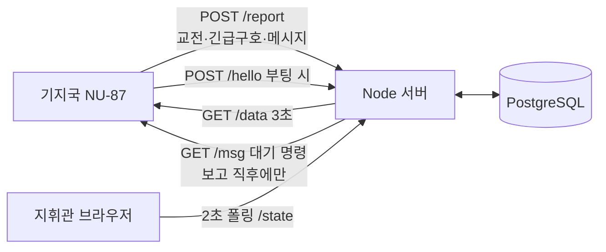

# 현맥 (玄脈) · C2 지휘소

**실시간 감시판이 아니라, 분대가 말을 걸 때만 듣고 답하는 지휘소.**

D4D × EDTH SEOUL 2026 출품작 · [firmware](https://github.com/hyeonmaek/firmware) · [app](https://github.com/hyeonmaek/app) · [web](https://github.com/hyeonmaek/web)

## 문제

| 문제 | 결과 |
|---|---|
| 지휘소가 수시로 명령을 내리면 분대 쪽 장비가 그때마다 전파를 낸다 | 은밀 행동 중 위치 노출 |
| 보고 위치가 좌표 숫자뿐이다 | 지휘관이 한눈에 어디인지 모른다 |
| "적이 저쪽"이라는 보고는 지도에 올리기 어렵다 | 방향 정보가 버려진다 |
| 대시보드가 연결 상태를 그럴듯하게 꾸민다 | 장비가 꺼져도 "연결됨"이면 판단을 그르친다 |

## 해법

| 문제 | 기술 | 구현 |
|---|---|---|
| 전파 노출 | **송신 연동 하달(store-and-forward)** | 명령은 DB에 대기. 분대 누구든 송신하는 순간 대기 명령 전부 하달. 전체 명령은 분대 전체에, 개별 명령은 지정 병사에게 |
| 위치 가독성 | **역지오코딩 + 캐시** | 좌표 → 행정구역(Nominatim) + 가장 가까운 도로명(Overpass). 결과를 DB에 저장, 1초 1건 대기열 |
| 방향 정보 | **진북 기준 방위선** | 보고 지점에서 방위각으로 100m 직선 + ±15° 오차 부채꼴 |
| 거짓 상태 | **기지국 실측 폴링** | 3초마다 기지국에 직접 물어 응답 여부로 표시. 아군 목록도 기지국이 6초 안에 실제로 들은 병사만 |

## 구조



## 핵심 기술

- **명령 전달 기록**: `command_deliveries`(명령 × 병사)로 누가 언제 받았는지 남긴다. 기지국이 한 번에 한 통만 방송하므로 받는 쪽별로 4초 간격 순차 하달
- **폰 없는 병사의 위치 근사**: GPS가 없는 보고는 BLE 거리(수십 m) 안 분대원의 10분 내 폰 좌표로 근사하고 "E-1 근처"로 명시
- **기지국 주소 자동 학습**: 기지국이 부팅 인사(`/hello`)나 보고를 보낸 주소를 기억. 루프백은 무시
- **대원 메시지 복원**: 기지국이 UTF-16LE 16진수로 올린 문장을 서버에서 복원
- **시각 표기**: 화면 시계에 군 DTG(`DDHHMMK`) 병기

## 화면

| 영역 | 내용 |
|---|---|
| 상단 | 기지국 연결 / 끊김(경과 시간) / 미확인 · 날짜·시각·DTG |
| 지도 | 위성/일반 전환. 보고 지점 라벨(병사, 종류, 날짜·시각, 주소, 좌표), 방위선 |
| 아군 현황 | 통신 중인 병사, 배터리, 신호 세기 |
| 보고 | 교전 / 긴급구호 / 메시지, 최신순 |
| 명령 | 대상(전체 + 통신 중인 병사만), 상태(대기 / 전달됨 / 받은 병사) |

## 실행

```sh
npm install && docker compose up -d && node server.js   # http://localhost:8090
npm test                                               # 방위선 교차 계산 시험
```
