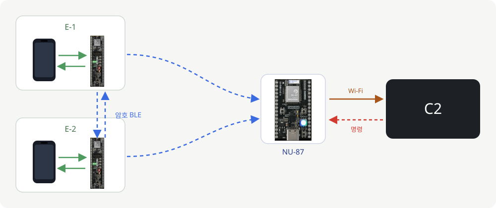
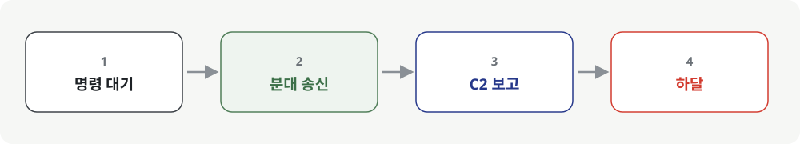

# 현맥 · C2

**분대가 말을 걸 때만 듣고, 그때만 답합니다.**

현맥 C2는 분대의 교전, 긴급구호, 메시지 보고를 지도에 띄우고 분대에 명령을 내리는 지휘 화면입니다.

[firmware](https://github.com/hyeonmaek/firmware) · [app](https://github.com/hyeonmaek/app) · [web](https://github.com/hyeonmaek/web)




## 🗺 지도

보고가 들어오면 지도에 병사 위치, 날짜와 시각, 도로명 주소, 좌표가 찍힙니다. 사격개시 보고에는 병사가 겨눈 방향이 진북 기준 직선과 ±15° 오차 부채꼴로 함께 그려집니다.

## 📡 명령

명령은 바로 나가지 않고 대기합니다. 분대 중 누구든 송신하는 순간 대기 중인 명령이 전부 내려갑니다. 전체 명령은 분대 모두에게, 개별 명령은 지정한 병사에게 갑니다. 평소에는 분대 쪽 장비가 반응하지 않게 하기 위해서입니다.



## ✅ 실제 상태만

연결 상태는 3초마다 게이트웨이에 직접 물어 확인합니다. 아군 현황과 명령 대상 목록에는 지금 실제로 통신 중인 병사만 나옵니다.

| 키워드 | 쓰임 |
|---|---|
| Store-and-forward | 송신 시점 명령 하달 |
| PostgreSQL | 보고, 명령, 전달 기록 |
| 역지오코딩 | 좌표를 도로명 주소로 |
| Leaflet | 위성 지도 |

## 🛠 실행

```sh
npm install && docker compose up -d && node server.js
```
